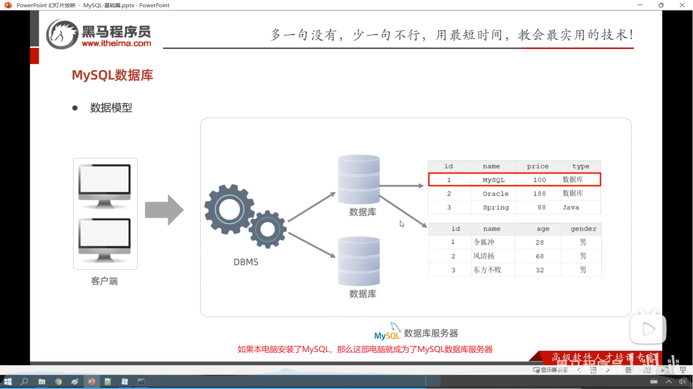

# MySQL概述

## 数据库相关概念

| 名称             | 含义                                             | 简称                                |
| :--------------- | ------------------------------------------------ | ----------------------------------- |
| 数据库           | 存储数据的仓库，数据有组织的存储                 | Database（DB）                      |
| 管理数据库的软件 | 操纵和管理数据库的软件                           | Database Management System （DBMS） |
| SQL              | 操作**关系型**数据库的一种编程语言，提供一套标准 | Structure Query Language（SQL）     |


主流关系型数据库：

Oracle，MySql等


## MySQL下载

### 启动与停止

启动

```cmd
net start mysql80
```

停止

```cmd
net stop mysql80
```

（80是安装MySQL默认的名字）


## MySQL数据库

### 客户端连接

法1. MySQL提供的客户端命令行工具


然后输入密码


法2. （已配置环境变量的前提下）

使用系统的cmd，执行命令：mysql [-h 127.0.0.1] [-P 3306] -u root -p

([]里面的东西可以省略， 默认连接是本机的mysql)

### 数据模型

客户端→DBMS→多个数据库→多个表（一个数据库可以有多个表）



### 关系型数据库

#### 概念

建立在关系模型上，由相互联系的二维表构成的数据库

通俗地讲，**关系型数据库就是把数据存成一张张“表格”，并且表格之间可以通过某些字段互相“关联”起来的数据库**。

#### 特点

1. 使用表存储数据

2. 使用SQL语言操作