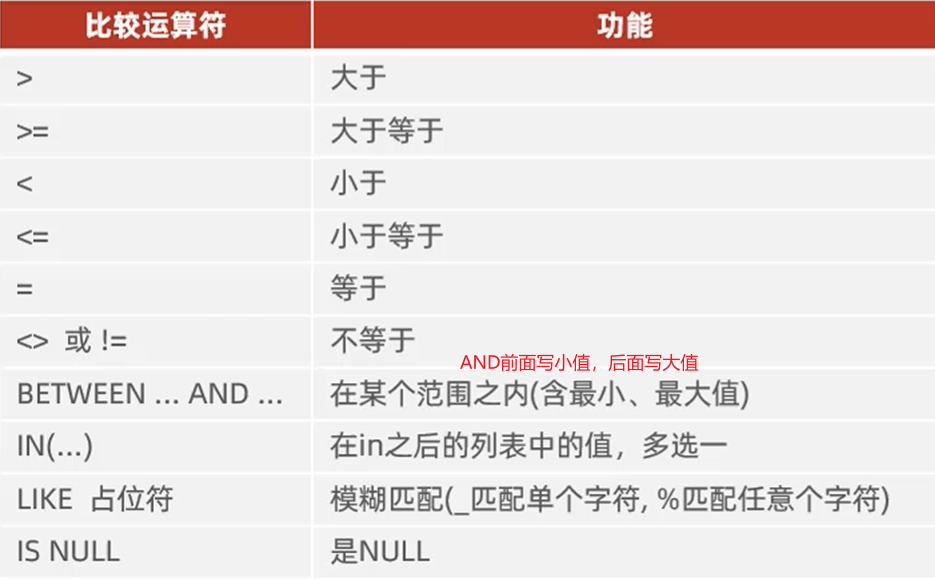
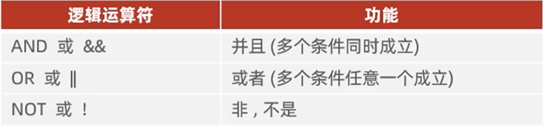

# SQL

## SQL通用语法

1. SQL可以单行写可以多行写，以；作为结尾（这一点有点像c语言和java）
2. 多用空格/缩进来增强相关语句的可读性
3. MySQL语句不区分大小写，关键字建议使用大写
4. 注释相关内容：
   - 单行注释：--注释内容或#注释内容
   - 多行注释：/\*注释内容\*/

## SQL语句的分类

| 分类 | 全称                       | 作用                                                   |
| ---- | -------------------------- | ------------------------------------------------------ |
| DDL  | Data Definition Language   | 数据**定义**语言，定义数据库对象（数据库，表，字段）   |
| DML  | Data Manipulation Language | 数据**操作**语言，对数据库中的数据进行增删改           |
| DQL  | Data Query Language        | 数据**查询**语言，查找数据库中的表的记录               |
| DCL  | Data Control Language      | 数据**控制**语言，创建数据库用户，管理数据库的访问权限 |

## DDL Data Definition Language，数据定义语言

### 数据库操作

#### 查询

1. 查询所有数据库

   ```sql
   SHOW DATABASES;
   ```

2. 查询当前数据库

   ```sql
   SELECT DATABASE();
   ```

#### 创建

1. 创建数据库

   ```sql
   CREATE DATABASE [ IF NOT RXISTS ] 数据库名 [ DEFAULT CHARSET 字符集] [ COLLATE 排序规则];
   ```

#### 删除

1. 删除数据库

   ```sql
   DROP DATABASE [ IF EXISTS ] 数据库名;
   ```

#### 使用

1. 使用数据库

   ```sql
   USE 数据库名;
   ```

### 表操作

#### 数据类型

 [MySQL数据类型.xlsx](MySQL数据类型.xlsx) 

#### 查询

1. 查询当前数据库中所有表

   ```sql
   SHOW TABLES;
   ```

2. 查询表结构

   ```sql
   DESC 表名;
   ```

3. 查询指定表的建表语句（即创建该表时输入了哪些信息）

   ```sql
   SHOW CREATE TABLE 表名;
   ```

#### 创建

```sql
CREATE TABLE 表名(
	字段1 字段1类型[COMMENT 字段1注释]，
	字段2 字段2类型[COMMENT 字段2注释],
	字段3 字段3类型[COMMENT 字段3注释],
	......
	字段n 字段n类型[COMMENT 字段n注释]
)[COMMENT 表注释];
```

#### 修改

1. 添加字段

   ```sql
   ALTER TABLE 表名 ADD 字段名 类型 (长度) [COMMENT 注释] [约束];
   ```

2. 修改数据类型

   ```sql
   ALTER TABLE 表名 MODIFY 字段名 新数据类型(长度);
   ```

3. 修改字段名和字段类型

   ```
   ALTER TABLE 表名 CHANGE 旧字段名 新字段名 类型(长度) [COMMENT 注释] [约束];
   ```

4. 修改表名

   ```sql
   ALTER TABLE 表名 RENAME TO 新表名;
   ```

   

#### 删除

1. 删除字段

   ```sql
   ALTER TABLE 表名 DROP 字段名;
   ```

2. 删除表

   ```sql
   DROP TABLE[IF EXISTS] 表名;
   ```

3. 删除指定表，并重新创建该表[表里的数据就没了]

   ```sql
   TRUNCATE TABLE 表名;
   ```

   

## DML Data Manipulation Language，数据操作语言

### 添加

1. 给指定字段添加数据

   ```sql
   INSERT INTO 表名(字段名1，字段名2，...) VALUES(值1，值2，...);
   ```

2. 给全部字段添加数据

   ```sql
   INSERT INTO 表名 VALUES(值1，值2，...);
   ```

3. 批量添加数据

   ```sql
   INSERT INTO 表名(字段名1，字段名2) VALUES(值1，值2，...)(值1，值2，...)(值1，值2，...)
   ```
	```sql
   INSERT INTO 表名 VALUES(值1，值2，...)(值1，值2，...)(值1，值2，...)
   ```
   

注意：

		* 插入数据，指定字段顺序与值顺序一致，如上面字段名1要对应值1...
		* 字符串和日期型数据要包含在引号内
		* 插入数据大小，应该在字段的规定范围内

### 修改

1. 修改数据

   ```sql
   UPDATE 表名 SET 字段名1=值1，字段名2=值2，...[WHERE 条件];
   ```

注意：

* 修改语句的条件可以有也可以没有，如果没有条件，会修改整张表的数据


### 删除

1. 删除数据

   ```sql
   DELETE FROM 表名 [WHERE 条件];
   ```

注意：

* DELETE语句的条件可以有也可以没有，如果没有会删除整张表的所有数据
* DELETE语句不能用于删除某一个字段的值（可以改用UPDATE语句）

## DQL Data Query Language，数据查询语言

### 语法

```sql
SELECT
		字段列表
FROM
		表名列表
WHERE
		条件列表
GROUP BY
		分组字段列表
HAVING
		分组后条件列表
ORDER BY
		排序字段列表
LIMIT
		分页列表
```

* 基本查询
* 条件查询(WHERE)
* 聚合函数(count,max,min,avg,sum)
* 分组查询(GROUP BY)
* 排序查询(ORDER BY)
* 分页查询(LIMIT)

### 基本查询

1. 查询多个字段

   ```sql
   SELECT 字段1，字段2，字段3，......FROM 表名;
   ```

   ```sql
   SELECT * FROM 表名;
   #一般不要写*
   ```

2. 设置别名

   ```sql
   SELECT 字段1 [AS 别名1]，字段2 [AS 别名2]，...... FROM 表名;
   #上面的AS可以省略
   ```

3. 去除重复记录（如果某值重复了就只显示一次）

   ```sql
   SELECT DISTINCT 字段列表 FROM 表名;
   ```

### 条件查询

1. 语法

   ```sql
   SELECT 字段列表 FROM 表名 WHERE 条件列表;
   ```

2. 条件

   

   

### 聚合函数

1. 定义：

   将一列数据作为一个整体，进行纵向计算

2. 常用聚合函数

   

3. 用法

```sql
SELECT 聚合函数（字段名） FROM 表名;
```

### 分组查询

1. 语法

```sql
SELECT 字段列表 FROM 表名 [WHERE 条件] GROUP BY 分组字段名 [HAVING 分组后过滤条件]
```

2. WHERE 和 HAVING的区别

   - 执行时机不同：

     - WHERE是分组前进行过滤，不符合分组条件就不参与分组；

     - HAVING是分组后进行过滤

   * 判断条件不同：
     - WHERE不能对聚合函数进行判断
     - HAVING可以对聚合函数进行判断

3. 注意：
   * 执行顺序：WHERE>聚合函数>HAVING
   * 分组之后，查询的字段一般为聚合函数和分组字段，查询其他字段毫无意义

### 排序查询

1. 语法

```sql
SELECT 字段列表 FROM 表名 ORDER BY 字段1 排序方式1,字段2 排序方式2；
```

2. 排序方式

   * ASC：升序（默认值）
   * DESC：降序

   注意：多字段排序时，第一个字段相同才会对第二字段进行排序

### 分页查询

1. 语法

```sql
SECECT 字段列表 FROM 表名 LIMIT 起始索引,查询记录数;
```

注意：

* 起始索引从0开始，起始索引=(查询页码-1)*每页显示记录数。
* 分页查询是数据库方言，不同数据库有不同的视线，MySQL是LIMIT。
* 如果查询的是第一页数据，起始索引可以省略，直接简写为LIMIT 查询记录数。

### 执行顺序

dql语句的编写顺序如下

```sql
SELECT
		字段列表
FROM
		表名列表
WHERE
		条件列表
GROUP BY
		分组字段列表
HAVING
		分组后条件列表
ORDER BY
		排序字段列表
LIMIT
		分页列表
```

但是其执行顺序不一样

```sql
FROM
		表名列表
WHERE
		条件列表
GROUP BY
		分组字段列表
HAVING
		分组后条件列表
SELECT
		字段列表
ORDER BY
		排序字段列表
LIMIT
		分页参数
```

## DCL Data Control Language，数据控制语言

### 管理用户

1. 查询用户

```sql
USE mysql;
SELECT * FROM user;
```

2. 创建用户

```sql
CREAT USER '用户名'@'主机名' INDENTIFIED BY '密码';
```

3. 修改用户密码

```sql
ALTER USER '用户名'@'主机名' IDENTIFIED WITH mysql_native_password BY '新密码';
```

4. 删除用户

```sql
DROP USER '用户名'@'主机名';
```

注意：

* 主机名如果设置为%，意思是所有主机都可以访问。
* 这类SQL开发人员操作比较少，主要是DBA（Database Administrator 数据库管理员）使用。

### 权限控制

MySQL定义了很多权限，以下是常用几种


1. 查询权限

```sql
SHOW GRANTS FOR '用户名'@'主机名';
```

2. 授予权限

```sql
GRANT 权限列表ON 数据库名.报名 TO '用户名'@'主机名';
```

3. 撤销权限

```sql
REVOKE 权限列表 ON 数据库名.表名 FROM '用户名'@'主机名';
```

注意：

* 多个权限之间，使用逗号分隔。
* 授权时，数据库名和表名可以使用*进行通配，表示所有。

## 补充核心八股：DDL/DML 与 DQL 执行逻辑

### 一、DELETE / TRUNCATE / DROP 的区别
| 命令 | 语言分类 | 执行机制 | 能否回滚 | 是否重置自增主键 |
| :--- | :--- | :--- | :--- | :--- |
| **DELETE** | DML | 逐行删除，记录事务日志 | 可以回滚 | 不重置 |
| **TRUNCATE** | DDL | 清空整表，不记录事务日志，速度快 | 不可回滚 | 重置为1 |
| **DROP** | DDL | 连表带结构彻底删除，连根拔起 | 不可回滚 | 完全销毁 |

### 二、WHERE 与 HAVING 的区别及执行顺序
**DQL 完整执行顺序：**
FROM -> WHERE -> GROUP BY -> HAVING -> SELECT -> ORDER BY -> LIMIT

**核心区别：**
- **WHERE**：在分组（GROUP BY）**之前**过滤原始数据行。因此**不能**使用聚合函数（如 count、sum、max）。
- **HAVING**：在分组（GROUP BY）**之后**过滤分组结果。因此**可以**使用聚合函数。