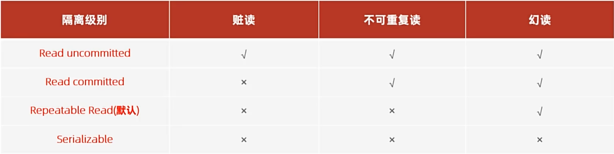

# 事务

## 事务简介

事务是一组操作的集合，是一个不可分割的工作单位。事务会把所有的操作作为一个整体一起向系统提交或撤销操作请求，也就是说，这些操作**要么同时成功，要么同时失败**

类比例子：转账

*开始事务*

- 查询A用户账户余额 是否有1000元
- 将A用户余额减少1000元	                 <——如果抛异常 *回滚事务*
- 将B用户账户余额增加1000元

*提交事务*

默认`MySQL`的事务是自动提交的，也就是说，执行一条`DML（数据操作语言）`语句时，`MySQL`会立即隐式的提交事务

## 事务操作

查看/设置事务提交方式

```sql
SELECT @@autucommit; #查看事务提交方式，值为1，是自动提交
SET @@automcommit = 0 #设置事务提交方式为手动提交
```

如果是“自动提交”，也可以通过如下方法开启事务

开启事务

```sql
START TRANSACTION 或 BEGIN;
```

提交事务

```sql
COMMIT;
```

回滚数据

```sql
ROLLBACK;
```

## 事务的四大特性（ACID）

### 原子性（Atomicity）

事务是不可分割的最小操作单元，要么全部成功，要么全部失败

联想到——`Java`的`Synchronized`

### 一致性（Consistency）

事务完成时，必须使所有的数据都保持一致

### 隔离性（Isolation）

数据库系统提供的隔离机制，保证事务在不受外部并发操作影响的独立环境下运行

### 持久性（Durability）

事务一旦提交或回滚，那么它对与数据库中数据的改变就是永久的

## 并发事务问题


## 事务隔离级别



查看事务隔离级别

```sql
SELECT @@TRANSACTION_ISOLATION;
```

设置事务隔离级别

```sql
SET 【SESSION|GLOBAL】 TRANSACTION ISOLATION LEVEL {READ UNCOMMITTED | READ COMMITTED | REPEATABLE READ | SERIALIZABLE}
```

注：【】中的是必填项，SESSION意思是会话级别，仅代表对于当前客户端窗口有效；GLOBAL指对所有客户端的会话窗口有效

**事务的隔离级别越高，数据越安全，性能越差**