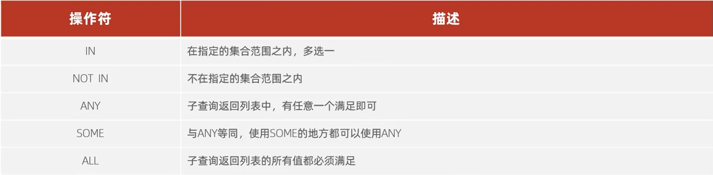

# 多表查询

## 多表关系

由于业务关联，很多表结构也存在着关联。

常见的关系：

- 一对多（多对一）
- 多对多
- 一对一

### 一对多

案例：部门与员工的关系

一个部门可以有多个员工，但是一个员工只能属于一个部门

实现：在“多”的那方建立外键，指向“一”的一方

### 多对多

案例：学生与课程的关系

一个学生可以选好多门课程，一门课可以有好多学生上

实现：建立第三张中间表，中间表至少包含两个外键，用于关联两个主键

### 一对一

案例：用户与用户详情的关系

一对一关系，多用于单表拆分，一张表的基础字段放在一张表里，详情字段放在另一张表里，以提升操作效率

实现：在任意一方加上主键，然后关联另一方的主键，并设置外键为唯一的（`UNIQUE`）

## 多表查询概述

### 概述

从多张表中查询数据

但是发现，直接

```sql
SELECT * FROM 表A,表B;#表A五条，表B6条
```

会查询到5*6=30条数据，因为这样子查询到的是“笛卡尔积”

#### 笛卡尔积

数学上，集合A和集合B所有组合的情况

多表查询，要删除掉没有用的多余的笛卡尔积

可以加上 `WHERE` 外键id相等 作为约束条件，从而达到删去冗余数据的效果

### 多表查询的分类

#### 连接查询

##### 内连接

查询集合A，集合B两者交集部分数据

##### 外连接

###### 左外连接

查询左表的所有数据，以及两者交集数据

###### 右外连接

查询右表所有数据，以及两者交集数据

##### 自连接

当前表与自身的连接查询，自连接必须使用别名

（一张表当两张表用）

#### 子查询

### 连接查询

#### 内连接(两张表的交集部分)

内连接查询语法

- 隐式内连接

```sql
SELECT 字段列表 FROM 表名1,表名2 WHERE 条件;
```

- 显式内连接

```sql
SELECT 字段列表 FROM 表1 [INNER] JOIN 表2 ON 连接条件;
```

注：多表查询时可以给表起别名，方便书写。但是由于`DQL`语句会先执行`FROM`，所以起完别名之后就不能再使用原名

#### 外连接

外连接查询语法

- 左外连接

```sql
SELECT 字段列表 FROM 表1 LEFT [OUTER] JOIN 表2 ON 条件;
```

查询左表以及左右表的交集部分

- 右外连接

```sql
SELECT 字段列表 FROM 表1 RIGHT [OUTER] JOIN 表2 ON 条件;
```

查询右表以及左右表的交集部分

注：左右外连接可以通过更换`RIGHT\LEFT JOIN `左边右边的表达到一个等效效果。`a LEFT JOIN b`等价于`b RIGHT JOIN a`

#### 自连接(查询表内数据间的关系)

自连接查询语法

```sql
SELECT 字段列表 FROM 表A 别名A JOIN 表A 别名B ON 条件;
```

自连接查询可以是内连接也可以是外连接

#### 联合查询

联合查询可以将几次查询结果拼起来，形成一个联合查询集

```sql
SELECT 字段列表 FROM 表A...
UNION [ALL]
SELECT 字段列表 FROM 表B...;
```

- 加上`ALL`是不去重版本，不带`ALL`自动去重
- `UNION` 两边 `SELECT` 的列数必须相同，并且对应位置的数据类型要兼容。
  列名可以不同，最终结果集的列名以第一个 `SELECT`的列名为准。

### 子查询

`SQL`语句中套嵌`SELECT`语句，称为套嵌语句，又叫子查询

```sql
SELECT * FROM 表1 WHERE column1 = (SELECT column1 FROM 表2);
```

子查询外部的语句可以是`INSERT` `UPDATE` `DELETE` `SELECT`中的任意一个

根据子查询的结果不同，可以分为

- 标量子查询（子查询结果为单个值）
- 列子查询（子查询结果为一列）
- 行子查询（子查询结果为一行）
- 表子查询（子查询结果多行多列）

根据子查询位置不同，可以分为

- WHERE之后
- FROM之后
- SELECT之后

#### 标量子查询

子查询返回的结果是单个值，（数字、字符串、日期等），最简单的形式，这种子查询叫做标量子查询

简单来说就是外层查询的条件来自于内层查询的结果

常用操作符：= <> > < >= <=

#### 列子查询

子查询返回的结果坏死一列（可以是多行），这种子查询叫做列子查询

常用操作符： IN 、NOT IN、ANY、SOME、ALL



#### 行子查询

行子查询返回的结果是一行（可以是多列），这种查询叫行子查询

常用操作符：= <> > < >= <=

#### 表子查询

子查询返回结果多行多列，这种子查询叫表子查询

常用操作符：IN